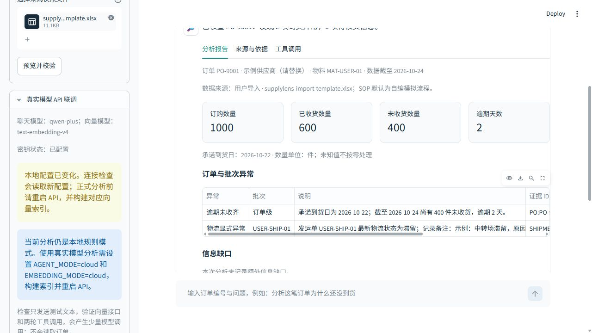
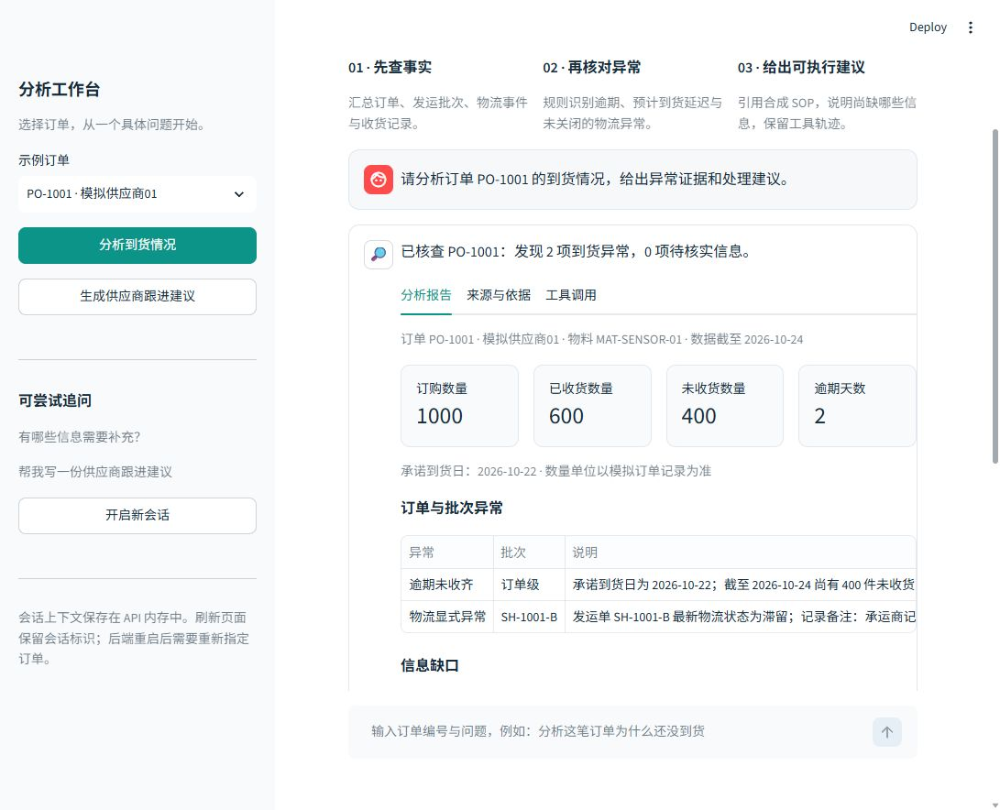

# SupplyLens Agent

**面向采购到货分析的工具调用 Agent：查订单、核对异常、检索 SOP，生成带证据的处理建议。**

SupplyLens 是一个可在本地运行的个人工程作品。内置订单、供应商、物流事件和 SOP 为合成数据，默认分析日期为 **2026-10-24**；也支持 Excel/CSV 导入用户数据快照，并逐单标记来源、覆盖范围与分析日期。

**v0.2 新增：** [Excel/CSV 导入与模板](docs/data-import.md)、[真实 API 连接检查](docs/cloud-integration.md)。没有提供收货表时显示未知，而不是零收货。模板使用示例数据，默认 SOP 仍为自编模拟流程。



输入：`分析订单 PO-1001 的到货情况，给出异常证据和处理建议。`

输出：订购 / 已收 / 未收数量、订单与批次异常、信息缺口、SOP 引用、跟进建议及工具调用记录。界面可下载 Markdown 报告。

## 演示



| 场景 | 实际运行报告 | 演示动图 |
| --- | --- | --- |
| `PO-1001` 逾期与物流异常 | [查看 Markdown](docs/demos/01-overdue.md) | [查看动图](docs/demos/01-overdue.gif) |
| 多轮追问与供应商跟进草稿 | [查看 Markdown](docs/demos/02-followup.md) | [查看动图](docs/demos/02-followup.gif) |
| `PO-1009` 信息不足 | [查看 Markdown](docs/demos/03-missing-data.md) | [查看动图](docs/demos/03-missing-data.gif) |

这些演示使用 SQLite 与无模型 Demo 工作流。业务结果和工具轨迹来自实际运行；GIF 由实际页面截图逐帧组装，并非实时录屏，原始 PNG 也保存在 `docs/demos/`。

## 核心设计

- **事实由工具取得。** 订单、物流、收货记录从数据库读取，汇总和到货判断由 Python 规则计算。
- **结论可以核对。** 报告保留业务证据 ID、原始字段与 SOP 引用，区分已观察到的异常和仍然缺失的信息。
- **建议采用原文约束。** Cloud 模型从本次检索的 SOP 完整原文行中选择建议，补充说明只允许预定义模板；业务事实和跟进草稿由程序生成。这减少新增定性事实的空间，代价是建议表达更固定。
- **演示与模型调用分开。** Demo 使用确定性 LangGraph 工具工作流；Cloud 才由真实模型选择工具。云端失败会报告错误，不偷偷切换成本地结果。
- **控制项目边界。** 工具只读取业务数据，运行报告另行持久化；跟进内容只生成草稿，不发送给供应商。

| 模式 | Agent | SOP 检索 | 是否需要密钥 |
| --- | --- | --- | --- |
| 默认 Demo | 确定性工具工作流，无 LLM 调用 | 本地词法 n-gram 哈希向量 | 否 |
| Cloud | 真实模型工具调用 | 云端 Embedding | 是 |
| Cloud + 本地检索 | 真实模型工具调用 | 本地词法 n-gram 哈希向量 | 是，仅聊天模型 |

本地检索属于词法基线，不能视作语义模型。Demo 的通过率只能说明这条确定性工作流在给定样例上的表现，不能当作真实模型 Agent 能力指标。

## 本地启动：SQLite + Demo

Windows 用户可以先看 [Windows 快速启动](docs/quickstart-windows.md)。

需要 Python 3.11–3.13 和 [uv](https://docs.astral.sh/uv/)。在仓库根目录执行：

```bash
uv sync --extra dev
uv run supplylens init
uv run supplylens index
uv run supplylens serve
```

另开一个终端，仍在仓库根目录执行：

```bash
uv run streamlit run ui/app.py
```

- 页面：[http://localhost:8501](http://localhost:8501)
- API 文档：[http://localhost:8000/docs](http://localhost:8000/docs)
- 健康检查：[http://localhost:8000/health](http://localhost:8000/health)

默认配置可直接运行，不需要 `.env` 或模型密钥。数据库与检索缓存保存在 `runtime/`。如需修改配置，将 `.env.example` 复制为 `.env`，再按需修改。

### 先试这几笔订单

| 订单 | 演示重点 |
| --- | --- |
| `PO-1001` | 订购 1000、已收 600；剩余 400 逾期，未收批次存在物流滞留 |
| `PO-1002` | 正常在途，避免把“未收货”直接判成异常 |
| `PO-1004` | ETA 晚于承诺日期，展示预计延期风险 |
| `PO-1006` | 已收齐，历史异常不应继续作为当前到货异常 |
| `PO-1008` | 已知 ETA 延期与未安排余量同时存在 |
| `PO-1009` | ETA 缺失，应呈现信息缺口 |

先询问 `分析 PO-1001 的到货情况`，再追问 `帮我写一份供应商跟进建议`。后端会话存于内存；浏览器 URL 保存会话标识，API 重启后会提示开启新会话。历史消息展示属于当前页面会话，刷新整个页面不会重放完整聊天记录。

## MySQL 部署

项目的 Compose 方案由 `db`、`api`、`ui` 三个服务组成：

```bash
docker compose up --build
```

浏览器访问 `http://localhost:8501`。API 使用 MySQL，UI 通过容器网络连接 API；本地快速启动仍默认使用 SQLite。请以 Compose 文件中的端口、环境变量和卷配置为准。

这是用于本地演示的部署配置，不包含生产环境的身份认证、TLS、租户隔离和备份策略。

## 使用真实模型

建议先运行 `uv run supplylens check-cloud`，或点击页面侧栏的“检查真实 API”。这会实际检查向量接口和两轮工具协议，只发送测试文本。详见[联调步骤](docs/cloud-integration.md)。

在 `.env` 中设置以下变量；密钥只保存在本地，切勿提交：

```dotenv
AGENT_MODE=cloud
EMBEDDING_MODE=cloud
MODEL_API_KEY=your-key-here
MODEL_BASE_URL=https://dashscope.aliyuncs.com/compatible-mode/v1
MODEL_NAME=qwen-plus
EMBEDDING_MODEL=text-embedding-v4
EMBEDDING_DIMENSIONS=1024
```

重新构建索引并重启 API：

```bash
uv run supplylens index
uv run supplylens serve
```

Cloud 模式需要网络访问和对应服务的模型权限，调用可能产生费用。界面仅在 API 提供真实用量时显示 tokens。切换模式或模型后需要使用匹配的索引；云端调用错误会显式失败。

## 验证与评测

```bash
uv run pytest
uv run ruff check src ui tests
uv run supplylens evaluate --mode demo --output evaluation/results/demo.json
```

配置有效密钥后，单独运行真实模型评测：

```bash
uv run supplylens evaluate --mode cloud --output evaluation/results/cloud.json
```

**已验证：** Python 3.11.16 与 3.12.14 下均有 168 项测试通过；两个版本的 30 个独立验收案例均全部通过，其中 5 个为故障注入案例，真实云模型调用数为 0。JUnit 报告：[Python 3.11](evaluation/results/pytest-py311.xml)、[Python 3.12](evaluation/results/pytest-py312.xml)。

真实页面已检查订单报告、工具轨迹、跟进草稿、`PO-1009` 缺失 ETA 的信息缺口提示，以及 API 重启后的上下文清理和提示。

Cloud 路径包括 15 项脚本化模型协议测试，以及 1 项真实 `ChatOpenAI` SDK／模拟 HTTP 传输测试；后者验证完整两轮工具调用与 usage 解析。这些离线测试不调用真实云 API；另有 14 项连接探针测试和 33 项导入测试。实际 DashScope 探针返回 HTTP 401；随后 AIHubMix 免费 GLM 工具调用及模板订单分析已跑通，详见 [联调记录](docs/cloud-integration.md)。批量真实模型业务评测、MySQL 运行和 Docker 部署尚未执行。MySQL 已做 DDL 编译检查，本机没有 Docker CLI。

完整状态、复现命令及结果解释见 [验证记录](docs/validation.md)；[Demo 评测原始结果](evaluation/results/demo.json)保留运行模式和样本范围。上述 30/30 是固定样例验收结果，不是开放域准确率。

## API 概览

| 接口 | 用途 |
| --- | --- |
| `GET /health` | 数据库状态、Agent / 检索模式、分析日期与后端启动标识 |
| `GET /api/orders` | 可分析的订单列表 |
| `POST /api/chat` | 提交 `message` 和可选 `session_id`，返回回答、报告和运行 ID |
| `GET /api/runs/{run_id}` | 查看持久化运行结果与工具调用记录 |
| `GET /api/imports/template` | 下载 Excel / CSV 模板 |
| `POST /api/imports/preview` | 上传、解析、校验和预览，不写业务表 |
| `POST /api/imports/commit` | 确认后按订单快照原子导入 |
| `GET /api/cloud/status` | 查看密钥是否配置及配置重启提示，不返回密钥 |
| `POST /api/cloud/check` | 真实模型工具调用与向量接口联调，仅发送测试文本 |

UI 使用 `.env` 或环境变量 `API_URL` 连接后端，默认 `http://127.0.0.1:8000`。精确字段和校验规则以 FastAPI `/docs` 为准。

## 继续了解

- [Windows 快速启动](docs/quickstart-windows.md)
- [Excel/CSV 导入与字段说明](docs/data-import.md)
- [真实模型 API 联调](docs/cloud-integration.md)
- [架构与业务边界](docs/architecture.md)
- [3 分钟演示脚本](docs/demo-script.md)
- [面试讲解与自检](docs/interview-guide.md)
- [验证记录与运行状态](docs/validation.md)
