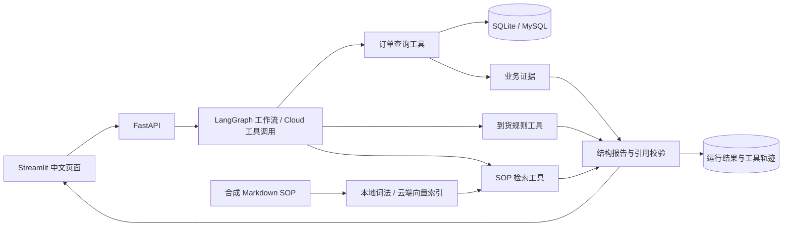

# 架构与业务边界

SupplyLens 聚焦一个问题：**根据截至指定日期的订单、发运、物流和收货记录，解释哪些到货问题需要处理，并给出有依据的下一步。**

## 数据流

Demo 模式使用确定性工具执行流程，不产生 LLM 推理或 token 指标。Cloud 模式由真实模型提出工具调用并选择 SOP 建议原文，业务规则和报告证据仍需经过代码约束。两种模式共用业务数据与规则。

## 数据与规则

- 业务实体包括供应商、采购订单、发运批次、物流事件和收货记录。合成数据可复现，适合展示分批发运、部分收货和缺失字段。
- 分析日期默认为 `2026-10-24`，按上海时区当日结束截断可见记录。分析只能使用该时点已知的物流事件、收货与 ETA 状态。
- 逾期未收、ETA 延期风险、物流异常分别判断。已收齐批次的旧异常不再作为当前到货异常。
- 信息缺口单独记录。已有一个明确异常，并不意味着其他缺失数据应被忽略；未触发异常也不等于全部风险已排除。
- 数量、日期差和事实汇总由 Python 计算。LLM 选择下一步工具和 SOP 原文行，事实描述与跟进草稿由程序生成。

分析报告包含事实、异常、信息缺口、业务证据、SOP 引用、建议、可选跟进草稿和补充说明。业务证据使用稳定 ID，异常和建议应指向对应依据。

## 报告约束与取舍

仅检查引用 ID 存在，无法阻止模型在同一段建议里添加未经证实的原因或责任判断。因此，本项目采用提取式建议：建议文本必须逐字等于本次检索段落中的一个完整原文行，引用必须对应本次检索结果。行首项目符号可被移除，正文不允许自由改写。模型补充说明只允许选择 `SAFE_NOTES` 中的固定模板。

程序负责生成事实描述和供应商跟进草稿。这些约束可以拒绝新增数字、无来源的责任归因和未检索到的引用，代价是建议表达受现有 SOP 限制。这里验证的是原文归属与输出约束，没有声称对自由生成建议进行了语义核实；SOP 对具体业务场景是否适用，仍需要人工判断。

## 检索

SOP 来自仓库中的中文合成 Markdown 文档。分块保留文档和标题来源，以便报告回溯。

- **Local：** n-gram 词法特征的哈希向量检索，无需模型密钥；无有效查询信号时返回空结果。
- **Cloud：** 调用兼容配置的 Embedding API；网络、权限或服务错误显式返回，不回退到 Local。
- 索引缓存包含内容与模型配置指纹。资料、检索模式或模型配置变化后，旧缓存不应被当作有效索引。

检索分数只是当前检索方式下的相似程度，不能直接解释为答案正确概率，也不能把 Local 与 Cloud 分数混在一起比较。

## API 与会话

`POST /api/chat` 接受用户消息和可选 `session_id`，返回运行状态、回答、结构报告、Markdown 和指标。状态分别为 `needs_input`、`completed`、`partial`、`failed`。

UI 把 `session_id` 与后端 `boot_id` 保存在查询参数中。API 的多轮上下文保存在内存；后端重启后，UI 清理旧上下文并提示用户重新指定订单。运行报告可通过运行 ID 查询，但持久化运行结果不等于恢复完整对话。

工具轨迹记录工具名、输入、输出、状态与耗时。Demo 不显示模型 token 用量；Cloud 也仅展示服务实际返回的计数。

## 已知边界

这是个人原型，不提供企业认证、访问授权、跨租户隔离或生产运维能力。数据与 SOP 均为合成资料，建议没有经过真实采购流程的业务验证。业务工具没有修改订单或发送消息的能力，运行报告写入使用独立路径。数据库层面的生产最小权限配置需单独建设，不能把“工具仅提供查询”描述成完整数据库权限隔离。

各环境的实测状态见 [验证记录](validation.md)。
