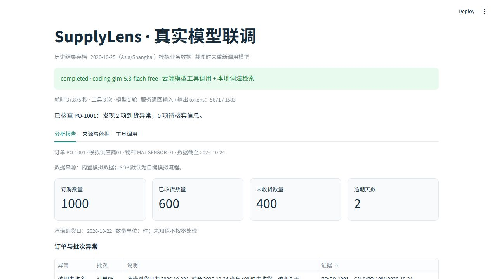

# 真实模型联调存档

运行日期：**2026-10-25（Asia/Shanghai）**。业务分析截至：**2026-10-24**。订单、物流、收货与 SOP 都是项目的模拟资料，模型 API 调用为真实请求。

| 项目 | 本次记录 |
| --- | --- |
| 模型 | `coding-glm-5.3-flash-free`，AIHubMix |
| 地址 | `https://api.aihubmix.com/v1` |
| 工作方式 | 云端模型工具调用 + 本地词法检索；未调用云端 Embedding |
| 订单与结果 | PO-1001；订购 1000、已收 600、未收 400 件；逾期 2 天，物流异常 |
| 状态与耗时 | completed，37875 ms |
| 调用次数 | 工具 3 次，模型 2 轮 |
| 实际返回的用量 | 输入 5671、输出 1583 tokens |

- [分析报告](2026-10-25-report.md)
- [结构化结果、证据与工具记录](2026-10-25-result.json)
- [报告截图](2026-10-25-report.png)
- [配置与排查说明](../cloud-integration.md)
- [不含密钥的 GLM 配置模板](../../.env.glm.example)

这是一次成功请求的存档，不是批量模型评测，不计入 Demo 的 30/30。Token 用量来自服务响应；没有计费账单，不据此推算金额或声称余额未变化。

JSON 从已保存的真实运行结果中选取报告、工具记录和指标，去除了会话标识。截图使用项目原有 Streamlit 报告组件显示这份存档，明确标为“历史结果”；截图时没有再次请求模型。原始运行文件、密钥和数据库留在本地。

接入时曾先遇到账号试用次数限制，之后通过账号额度处理恢复；随后原域名连接失败，使用官方公布的边缘地址完成验证。没有把连接失败或额度提示当成成功分析，也没有在失败后偷偷切换为 Demo 或收费模型。免费可用性、账号门槛和速率限制以平台当时的规则为准。
