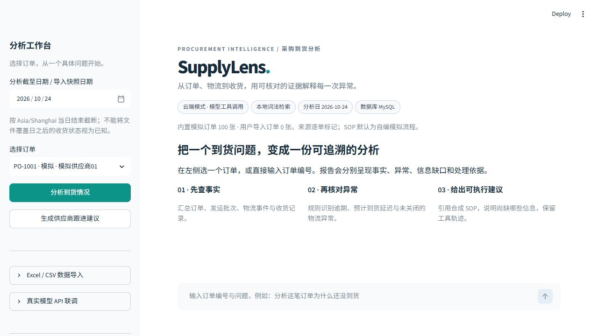

# MySQL 接入与实际验证

**2026-10-26，Windows 本机 MySQL Community Server 8.4.13 验证通过。** 本地项目已切换到 MySQL；原 SQLite 文件和切换前配置保留在被 Git 忽略的 `runtime/`。本次没有新增真实模型请求。

## 验证了什么

| 验证项 | 实际结果 |
| --- | --- |
| 建表 | 8 张表：供应商、采购单、发运、ETA、物流事件、收货、导入来源、运行记录 |
| 模拟数据 | 100 张采购单、10 家供应商；重复初始化没有重复数据 |
| 标准订单 | PO-1001：订购 1000、已收 600、未收 400 件、逾期 2 天 |
| Excel / CSV | Excel 预览不写入；确认后导入；CSV 更新同一订单，未收数量变为 350，没有重复发运记录 |
| 数据库约束 | 孤立发运被外键拒绝；同一事务中先插入的供应商也被回滚 |
| 运行记录 | Demo 图执行完成，JSON、中文内容及报告可保存、重载 |
| 原库迁移 | 8 张表逐行内容一致，保留 100 张订单、25 条历史运行及其 JSON 内容 |
| HTTP 查询 | 实际 `/health` 报告 `database_backend=mysql`，`/api/orders` 返回 100 张订单 |

独立验证库与实际应用库分开。独立验证库包含导入更新的 PO-9001；应用库迁移原有数据，继续保持原订单集。后续 API 验证会新增一条测试运行记录，因此当前运行记录数可以大于迁移时的 25。

- [真实 MySQL 八阶段结果](../evaluation/results/mysql.json)
- [SQLite → MySQL 内容校验结果](../evaluation/results/mysql-migration.json)
- [HTTP 查询和 Demo 报告重载结果](../evaluation/results/mysql-api.json)



## 接入已有 MySQL

使用 [MySQL 官方 Windows 安装包或 ZIP 便携包](https://dev.mysql.com/downloads/mysql/8.4.html?os=3)。本次便携程序放在本机 `.local-files/mysql/`，数据与私有配置位于 `runtime/mysql/`，只监听 `127.0.0.1:3307`，使用本地生成的随机密码。二进制、密码、日志和真实数据库文件均不提交。

在自己的服务器上通过管理员客户端创建项目专用库和用户，例如：

```sql
CREATE DATABASE supplylens CHARACTER SET utf8mb4 COLLATE utf8mb4_0900_ai_ci;
CREATE USER 'supplylens'@'127.0.0.1' IDENTIFIED BY 'replace_with_local_password';
GRANT ALL PRIVILEGES ON supplylens.* TO 'supplylens'@'127.0.0.1';
```

把 [`.env.mysql.example`](../.env.mysql.example) 的数据库配置写入本地 `.env`，按自己的主机和端口修改，使用自己设置的密码。密码包含 URL 特殊字符时需进行 URL 编码。保持既有 `MODEL_*`、`AGENT_MODE` 和 `EMBEDDING_MODE` 配置，数据库切换不要求切换模型。

首次使用空数据库与模拟数据：

```bash
uv run supplylens init
uv run supplylens serve
uv run streamlit run ui/app.py
```

`init` 会建表；只有采购单表为空时才导入模拟数据。若要迁移现有 SQLite，先按下一节迁移，**不要先向目标库导入模拟数据**。页面顶部与健康接口会显示当前数据库类型。

## 迁移现有 SQLite

暂停旧 API 写入并备份 SQLite。在当前进程环境里设置 `MYSQL_TARGET_URL`，指向一个已创建的空 MySQL 库；不要将真实凭据提交到仓库或公共终端记录。

```bash
uv run python scripts/migrate_sqlite_to_mysql.py --source runtime/supplylens.db --output runtime/mysql-migration.json
```

脚本只读打开源文件，按外键顺序在单事务中复制业务、导入来源及历史报告，逐行校验 JSON、日期和字段后提交。目标任何项目表非空会拒绝；不删除源文件、不清空目标、不执行 DROP。建表 DDL 可能在失败后保留，但复制的行会回滚。迁移成功后再修改应用 `DATABASE_URL` 并重启 API。

MySQL 时间列使用 `DATETIME(6)`，保留 SQLite 中的微秒，避免物流事件排序和历史运行时间在迁移时丢失精度。已有旧 MySQL 表的 `create_all` 不会自动改列类型，升级旧数据库时应先备份并按自己的库做迁移；本次验证使用新库。

## 复现隔离验证

在进程环境设置 `MYSQL_VERIFICATION_URL`，使用有创建测试库权限的 MySQL 账号，然后运行：

```bash
uv run python scripts/verify_mysql.py --output evaluation/results/mysql.json
```

每次创建全新的 `supplylens_verification_日期_随机值` 数据库，忽略连接中原来的数据库名，不执行 DROP，保留供检查。这里会产生专用测试数据，不会改动应用库；脚本使用 Demo 模式和本地检索，真实模型调用数为零。输出包含实际版本、阶段结果和耗时，不含密码、连接 URL 或本机文件路径。新增脚本的离线测试验证保护逻辑，不能替代上述真实 MySQL 运行结果。

## Docker 与边界

原有 `docker compose up --build` 仍提供 MySQL、API、UI 三服务方案。Compose 需 **2.24+**，API 可选读取本地 `.env` 中的模型参数，容器数据库连接由 `environment` 覆盖为 `db:3306`。`.dockerignore` 排除 `.env`、本地 MySQL 文件、数据和辅助目录。

本次跑通的是 Windows 本机 MySQL，**没有启动 Docker 容器**，不能将本次结果写成 Compose 部署已验证。数据库流程通过也不代表新的真实模型准确率评测；模型、导入业务规则与 MySQL 集成的成绩分别记录。
